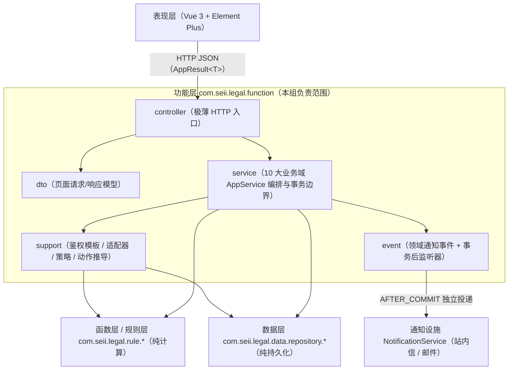

# 功能层内部设计与实现规范

> **文档定位与范围边界**：本文档仅约束后端 **功能层（`com.seii.legal.function`）** 的内部架构、设计模式落地与编排实现规范。
> 对外严格遵循仓库既有的跨组契约：[总纲.md](总纲.md)、[功能层对页面接口.md](功能层对页面接口.md)、[对数据层.md](对数据层.md)、[对函数层.md](对函数层.md)，**零侵入前端、函数层与数据层的既定接口**。

## 一、功能层架构定位与分层红线

### 1. 体系结构视图

功能层采用 **严格分层架构（Layered）+ 内部事件驱动通知（Event-Driven）**，作为表现层与下层能力之间的编排枢纽：



### 2. 分层依赖红线

1. **只编排，不越权**：身份凭证核验、角色权限判断、数据范围（`DataScope`）计算、事务边界（`@Transactional`）和用例顺序安排全部落在功能层；不在功能层硬编码切分/评分/一致度等纯规则算法，也不直接操作 JDBC/MyBatis/SQL。
2. **对外零侵入**：前端载荷形态差异（如平铺四字段 vs `content` 对象）、单文书 `documentId` 与 `AnnotationTask.documentIds` 的映射、下层异常文案包装，全部在功能层 `support` 适配消化。
3. **单向依赖与信息隐藏**：Controller 不直接访问 Repository 或 Rule；DTO 隔离页面 JSON 与 `data.entity`，避免数据库实体变化直接破坏页面协议。
4. **通知与主事务隔离**：业务 Service 只负责发布领域事件，不直接耦合邮件发送失败处理；监听器在主事务提交后投递通知，邮件服务不可用时保留站内消息且不回滚主业务。

---

## 二、功能层内部包结构与职责分工

```text
com.seii.legal.function
├─ controller                         // 极薄 REST 入口（@RequestMapping("/app/...")），只收凭证、校验参数、转发 Service
│  ├─ AuthController                  // AUTH-01…05
│  ├─ AdminController                 // ADMIN-01…07
│  ├─ DocumentController              // DOC-01…04
│  ├─ PublicQueryController           // USER-01、GUIDE-01
│  ├─ TaskController                  // TASK-01…08
│  ├─ AnnotationController            // ANNO-01…05
│  ├─ AdjudicationController          // ADJ-01…09
│  ├─ ExportController                // EXP-01…03
│  ├─ TeacherController               // TCH-01…14
│  ├─ StudentController               // STU-01…08
│  └─ TeachingAdminController         // TA-01…06
├─ dto                                // 按业务域分包/分文件组织 Request / Response record
│  ├─ auth / admin / document / task / annotation / adjudication / export / teacher / student / teachingadmin
├─ service                            // 10 大业务域 + 公共查询 AppService（高内聚用例编排与事务管控）
│  ├─ AuthAppService
│  ├─ AdminAppService
│  ├─ DocumentAppService
│  ├─ PublicQueryAppService
│  ├─ TaskAppService
│  ├─ AnnotationAppService
│  ├─ AdjudicationAppService
│  ├─ ExportAppService
│  ├─ TeacherAppService
│  ├─ StudentAppService
│  └─ TeachingAdminAppService
├─ support                            // 功能层内部设计模式支撑（不暴露给其他层）
│  ├─ AuthActionTemplate              // 【模板方法】统一鉴权、启停检查、角色核验、范围解析
│  ├─ AnnotationPayloadAdapter        // 【适配器】平铺 4 字段 ↔ content JSON ↔ Submission.content 互转
│  ├─ TaskDocumentAdapter             // 【适配器】单数 documentId ↔ List<String> documentIds 映射
│  ├─ TaskQueryStrategy               // 【策略接口】按登录身份分派“我的任务”查询
│  ├─ TaskQueryDispatcher             // 【策略路由】按 IdentityType 查找并执行对应 TaskQueryStrategy
│  ├─ AllowedActionResolver           // 【状态/策略映射】按 (TaskStatus, IdentityType) 推导 allowedActions
│  └─ GlobalExceptionHandler          // 【异常适配】统一将鉴权/业务/参数异常封装为 AppResult.fail
└─ event                              // 【观察者】功能层内部领域通知事件
   ├─ DomainNotificationEvent         // 事件载体（接收人、类型、主题、内容、是否发邮件）
   └─ NotificationEventListener       // @TransactionalEventListener(AFTER_COMMIT) 调用 NotificationService
```

---

## 三、功能层内部设计模式落地（5 项核心模式）

所有设计模式均**内化在 `com.seii.legal.function` 内部**，直接解决功能层真实痛点（重复鉴权、多身份分支、上下游格式差异、通知耦合、动作按钮推导），不改变任何跨组接口签名。

### 1. 模板方法模式（Template Method）：`AuthActionTemplate`

**解决痛点**：原 `总纲.md` 示例中，每个 Service 方法都需要重复编写 15–20 行“读凭证 → 查账号 → 判启用 → 判角色 → 算范围”的样板代码，70+ 接口极易漏检。

**实现设计**：抽取统一模板方法 `execute(...)`，将不变的鉴权骨架固化在模板中，各业务用例只需传入回调执行核心编排：

```java
package com.seii.legal.function.support;

import com.seii.legal.common.enums.DataScope;
import com.seii.legal.common.enums.IdentityType;
import com.seii.legal.common.enums.LoginUser;
import com.seii.legal.common.result.AppResult;
import com.seii.legal.data.entity.Account;
import com.seii.legal.data.repository.AccountRepository;
import com.seii.legal.data.repository.SessionRepository;
import com.seii.legal.rule.identity.IdentityRule;

import lombok.RequiredArgsConstructor;
import org.springframework.stereotype.Component;

import java.util.Set;
import java.util.function.Function;

@Component
@RequiredArgsConstructor
public class AuthActionTemplate {

    private final SessionRepository sessionRepository;
    private final AccountRepository accountRepository;
    private final IdentityRule identityRule;

    public record AuthContext(LoginUser user, Account account, DataScope scope) {
    }

    /**
     * 模板方法：凭证核验 -> 账号启用检查 -> 角色与本次身份校验 -> 数据范围解析 -> 执行业务回调
     */
    public <T> AppResult<T> execute(
            String credential,
            Set<IdentityType> allowedIdentities,
            String taskId,
            String classId,
            String forbiddenMessage,
            Function<AuthContext, AppResult<T>> action) {
        LoginUser user = sessionRepository.findByCredential(credential)
                .orElseThrow(() -> new IllegalStateException("登录已失效，请重新登录"));
        Account account = accountRepository.findById(user.accountId())
                .orElseThrow(() -> new IllegalStateException("账号不存在"));
        if (!identityRule.isEnabled(account)) {
            return AppResult.fail("账号已停用，请联系管理员");
        }
        if (allowedIdentities != null && !allowedIdentities.isEmpty()) {
            boolean permitted = allowedIdentities.contains(user.identity())
                    && identityRule.hasRole(account, user.identity());
            if (!permitted) {
                return AppResult.fail(forbiddenMessage);
            }
        }
        DataScope scope = identityRule.resolveScope(user, taskId, classId);
        return action.apply(new AuthContext(user, account, scope));
    }
}
```

### 2. 适配器模式（Adapter）：`AnnotationPayloadAdapter` 与 `TaskDocumentAdapter`

**解决痛点**：
1. 前端 `ANNO-04/05` 在不同页面或迭代中可能传嵌套 `content: { pieces, segments, relations, diagram }`，也可能传顶层平铺四字段；而数据层 `Submission.content` 存储的是序列化 JSON 字符串。
2. 页面接口 `TASK-01/05/06` 传递单数 `documentId`，而数据层 `AnnotationTask` 字段为 `List<String> documentIds`。

**实现设计**：在 `function.support` 内建立专用适配器，双向转换并做空值归一化，彻底屏蔽前后端及数据层的结构差异：

```java
package com.seii.legal.function.support;

import com.fasterxml.jackson.core.JsonProcessingException;
import com.fasterxml.jackson.databind.ObjectMapper;
import lombok.RequiredArgsConstructor;
import org.springframework.stereotype.Component;

import java.util.List;
import java.util.Map;

@Component
@RequiredArgsConstructor
public class AnnotationPayloadAdapter {

    private final ObjectMapper objectMapper;

    public record AnnotationContent(
            List<Map<String, Object>> pieces,
            List<Map<String, Object>> segments,
            List<Map<String, Object>> relations,
            List<Map<String, Object>> diagram
    ) {
    }

    /** 兼容嵌套 content 与平铺 4 字段，统一归一化并序列化为 Submission.content */
    public String toStorageJson(AnnotationContent nested, AnnotationContent flat) {
        AnnotationContent effective = (nested != null) ? nested : flat;
        AnnotationContent normalized = new AnnotationContent(
                effective != null && effective.pieces() != null ? effective.pieces() : List.of(),
                effective != null && effective.segments() != null ? effective.segments() : List.of(),
                effective != null && effective.relations() != null ? effective.relations() : List.of(),
                effective != null && effective.diagram() != null ? effective.diagram() : List.of()
        );
        try {
            return objectMapper.writeValueAsString(normalized);
        } catch (JsonProcessingException e) {
            throw new IllegalStateException("标注内容序列化失败");
        }
    }

    /** 将数据层 JSON 字符串还原为前端结构对象 */
    public AnnotationContent fromStorageJson(String contentJson) {
        if (contentJson == null || contentJson.isBlank()) {
            return new AnnotationContent(List.of(), List.of(), List.of(), List.of());
        }
        try {
            return objectMapper.readValue(contentJson, AnnotationContent.class);
        } catch (JsonProcessingException e) {
            throw new IllegalStateException("标注内容解析失败");
        }
    }
}
```

### 3. 策略模式（Strategy）：`TaskQueryStrategy` + `TaskQueryDispatcher`

**解决痛点**：`TASK-05`（`GET /task/my`）需根据当前登录身份调用不同的数据层查询（`TASK_MANAGER → findByManager`、`ANNOTATOR → findByAnnotator`、`ARBITER → findByArbiter`、`ADMIN → findAll`），若堆砌在 Service 中会形成冗长分支。

**实现设计**：利用 Spring 容器自动注入策略列表，按 `IdentityType` 路由分发：

```java
package com.seii.legal.function.support;

import com.seii.legal.common.enums.IdentityType;
import com.seii.legal.common.page.PageResult;
import com.seii.legal.data.entity.AnnotationTask;

public interface TaskQueryStrategy {
    IdentityType supportedIdentity();

    PageResult<AnnotationTask> queryMyTasks(String accountId, int page, int size);
}
```

```java
package com.seii.legal.function.support;

import com.seii.legal.common.enums.IdentityType;
import com.seii.legal.common.page.PageResult;
import com.seii.legal.data.entity.AnnotationTask;
import org.springframework.stereotype.Component;

import java.util.List;
import java.util.Map;
import java.util.function.Function;
import java.util.stream.Collectors;

@Component
public class TaskQueryDispatcher {

    private final Map<IdentityType, TaskQueryStrategy> strategyMap;

    public TaskQueryDispatcher(List<TaskQueryStrategy> strategies) {
        this.strategyMap = strategies.stream()
                .collect(Collectors.toMap(TaskQueryStrategy::supportedIdentity, Function.identity()));
    }

    public PageResult<AnnotationTask> dispatch(IdentityType identity, String accountId, int page, int size) {
        TaskQueryStrategy strategy = strategyMap.get(identity);
        if (strategy == null) {
            return new PageResult<>(List.of(), 0, page, size);
        }
        return strategy.queryMyTasks(accountId, page, size);
    }
}
```

### 4. 状态/动作推导器：`AllowedActionResolver`

**解决痛点**：`AppResult<T>` 要求每次返回 `allowedActions` 供前端渲染下一步按钮；如果每个接口各自硬编码按钮文案，状态变化时极易不一致。

**实现设计**：集中维护 `(TaskStatus, IdentityType) → List<String>` 映射表，统一输出符合业务流程的下一步操作：

| 任务状态（`TaskStatus`） | `TASK_MANAGER` | `ANNOTATOR` | `ARBITER` |
| --- | --- | --- | --- |
| `DRAFT` | `发布任务`、`修改任务`、`撤回任务` | `[]` | `[]` |
| `PUBLISHED` | `修改任务`、`查看进度`、`撤回任务` | `阅读指南`、`保存草稿`、`提交切分` | `查看进度` |
| `CUTTING_PENDING` | `查看进度`、`重开本轮` | `查看已提交切分` | `比对标注`、`裁定冲突`、`保存统一切分` |
| `CUTTING_CONFIRMED` | `查看进度`、`重开本轮` | `保存草稿`、`提交结构化标注` | `查看统一切分` |
| `STRUCTURED_PENDING` | `查看进度`、`重开本轮` | `查看已提交标注` | `比对标注`、`裁定冲突`、`图示审查`、`确认最终版本` |
| `REOPENED` | `查看进度` | `继续修改并重新提交` | `查看历史裁定` |
| `CONFIRMED` | `查看最终版本`、`导出数据` | `查看最终版本` | `查看最终版本` |
| `WITHDRAWN` | `查看撤回原因` | `[]` | `[]` |

### 5. 观察者模式（Observer / Spring Event）：`DomainNotificationEvent`

**解决痛点**：审批、发布/修改/撤回/重开任务、退回修改、专家回复、教师反馈都需要发送站内消息（部分还需发邮件），直接写在核心事务中既造成代码臃肿，又可能因学校邮件服务超时导致业务事务失败。

**实现设计**：功能层 Service 通过 `ApplicationEventPublisher` 发布事件，监听器在主事务提交后投递通知并隔离邮件异常：

```java
package com.seii.legal.function.event;

import java.util.List;

public record DomainNotificationEvent(
        List<String> receiverIds,
        String type,
        String subject,
        String content,
        boolean sendMail
) {
}
```

```java
package com.seii.legal.function.event;

import com.seii.legal.rule.notification.NotificationService;
import lombok.RequiredArgsConstructor;
import org.springframework.stereotype.Component;
import org.springframework.transaction.event.TransactionPhase;
import org.springframework.transaction.event.TransactionalEventListener;

@Component
@RequiredArgsConstructor
public class NotificationEventListener {

    private final NotificationService notificationService;

    @TransactionalEventListener(phase = TransactionPhase.AFTER_COMMIT, fallbackExecution = true)
    public void onDomainNotification(DomainNotificationEvent event) {
        if (event.receiverIds() == null || event.receiverIds().isEmpty()) {
            return;
        }
        for (String receiverId : event.receiverIds()) {
            notificationService.sendInApp(receiverId, event.content(), event.type());
            if (event.sendMail()) {
                try {
                    notificationService.sendMail(receiverId, event.subject(), event.content());
                } catch (Exception ignored) {
                    // 遵循总纲约定：学校邮件服务不可用时保留站内消息，不影响主流程
                }
            }
        }
    }
}
```

---

## 四、十大业务域 AppService 编排契约总表

下表严格对应原版 [功能层对页面接口.md](功能层对页面接口.md) 中的全部接口，明确每个 `AppService` 的鉴权身份、数据范围、事务属性、幂等要求、下层调用链与领域事件：

| AppService | 负责接口 | 允许身份 | DataScope / 归属校验 | 事务 & 幂等 | 核心编排顺序与事件 |
| --- | --- | --- | --- | --- | --- |
| `AuthAppService` | `AUTH-01…05` | 公开（01/04）；已登录（02/03/05） | 本人账号 | 写会话/申请 `@Transactional` | 登录：`findByAccount` → 校验密码 → `isEnabled` → `availableIdentities` → 唯一身份直接 `SessionRepository.save`（多身份返回 `options`）；选身份校验 `hasRole` 后更新会话；登出删凭证。 |
| `AdminAppService` | `ADMIN-01…07` | `ADMIN` | `ALL_TASKS`（全局） | 审批/改角色/导入指南 `@Transactional` | 审批：`nextApplicationStatus` → 批准建号并赋角色 → `updateStatus/saveApproval` → 发通知事件；改角色：校验 `atLeastOneRole` + `canModifyOtherRole` → 同事务写角色/状态/日志；导入指南：`canSaveVersion` + `readLabels` → `saveVersion`；总体情况：`findAll` + `findProgress`。 |
| `DocumentAppService` | `DOC-01…04` | `TASK_MANAGER`、`TEACHER`（读详情兼 `ANNOTATOR`/`ARBITER`/`ADMIN`） | 按 `SystemType` 隔离 | 上传/保存案件信息 `@Transactional` | 上传：`recognizeDocumentType` + `locateReasoning` + `parseCaseInfo` → `findByCaseNo` 查重 → 未重则 `save` + `saveCaseInfo`；保存案件信息：`checkCaseInfo` → `saveCaseInfo`。 |
| `PublicQueryAppService` | `USER-01`、`GUIDE-01` | 任意已登录角色 | 只读公共列表 | `readOnly = true` | `USER-01` 调 `AccountRepository.search(keyword, identity, ...)` 过滤启用账号；`GUIDE-01` 调 `GuideRepository.findAvailable`。 |
| `TaskAppService` | `TASK-01…08` | `TASK_MANAGER`（增改发撤重开）；`TASK_MANAGER`/`ANNOTATOR`/`ARBITER`（查列表/详情/进度） | 管理者仅本人任务；标注员/仲裁员仅分配给自己的任务 | 创建/发布/修改/撤回/重开 `@Transactional` | 创建：`TaskDocumentAdapter` 转 `List.of(documentId)` → `checkPublish` / `hasEnoughAnnotators` / `hasSingleArbiter` → `save` + `saveAssignment` + `saveReference`；发布/修改/撤回/重开校验 `TaskRule.nextStatus` 后更新状态并发布通知事件；`TASK-05` 走 `TaskQueryDispatcher`。 |
| `AnnotationAppService` | `ANNO-01…05` | `ANNOTATOR`（只读查看兼 `ARBITER`/`TASK_MANAGER`） | `OWN_TASKS`（必须属于 `task.annotatorIds`） | 保存草稿/提交 `@Transactional`；`ANNO-05` 透传 `requestId` 幂等 | 加载：先查 `findDraft`，再查本轮 `findSubmissions` 判断只读；保存/提交经 `AnnotationPayloadAdapter` 兼容平铺与嵌套载荷；提交前检 `canSubmit`、`nextStatus` 及轮次完备性（切分轮 `findUncut` / 结构化轮 `findUnassigned`、`findIsolated`、`checkConsistency`），调 `saveSubmission(sub, requestId)` 后算 `progress`。 |
| `AdjudicationAppService` | `ADJ-01…09` | `ARBITER`（01–04、07–09）；`EXPERT`（05–06）；终版查看兼 `TASK_MANAGER`/`ANNOTATOR` | `TASK_SUBMISSIONS`（必须 `task.arbiterId == user.accountId`） | 裁定/专家问答/审查/终版确认 `@Transactional` | 比对：取甲乙 `Submission` → `AdjudicationRule.difference/classify`（80% 线）；裁定：`saveDecision`；专家问答：存问题/回复 + 改状态 + 发通知事件；终版确认：`checkFinalVersion` 通过后**同事务**调 `saveFinalVersion` + `confirmTask`。 |
| `ExportAppService` | `EXP-01…03` | `TASK_MANAGER`（兼 `ADMIN`） | 仅本人创建且状态为 `CONFIRMED` 的任务 | 导出/再导入 `@Transactional`；`EXP-02` 透传 `requestId` 幂等 | 可导出列表过滤 `CONFIRMED`；导出先检 `fileNameExists` → `assemble`/`toJson`/`toExcel` → `saveRecord(record, requestId)` + `saveFile`；再导入调 `ExportRule.parseImport`，校验全部通过才 `TaskRepository.save` 建新草稿，失败直接返回错误不做部分导入。 |
| `TeacherAppService` | `TCH-01…14` | `TEACHER` | `OWN_CLASS`（仅本人创建的知识点/材料/题目/练习与所带班级） | 全部写接口 `@Transactional` | 知识点检 `uniquePointName`；材料发布检 `checkMaterialPublish`；题目修改调 `checkQuestion` + `nextVersion` + `saveQuestionVersion` 保留旧版；班级学习与薄弱点：`findWeakThreshold` 无值兜底 `60` → `weakPoints` / `targetedQuestions`；反馈与改分校验非空后落库并发布通知事件。 |
| `StudentAppService` | `STU-01…08` | `STUDENT` | `OWN_CLASS`（材料/练习）+ `OWN_ANSWERS`（作答/学习统计） | 草稿/提交 `@Transactional`；`STU-05` 透传 `requestId` 幂等 | 作答提交：检 `canSubmit` 与 `allowRedo` → `saveAnswer(answer, requestId)` → 逐题调 `TeachingRule.score` + `average` → `updateAnswerScore` + `saveDifference` → 返回得分、差异与系统反馈；详情读取 `findDifferences` + `findTeacherFeedback`。 |
| `TeachingAdminAppService` | `TA-01…06` | `TEACHING_ADMIN` | `TEACHING_ACCOUNTS`（仅教学系统） | 名单导入/审批 `@Transactional` | 名单导入：读文件逐行调 `checkRow`/`classAction`/`uniqueStudentNo`/`matchTeacher`/`studentClass` → 事务内 `saveClass` + `createStudentAccount` + `saveClassMember`/`transferClass` + `saveImportRecord`；审批仅处理 `SystemType.TEACHING` 且身份限定 `TEACHER|STUDENT`，批准后发布通知事件。 |

### 典型编排示例（重构后的 `AdjudicationAppService`）

借助 `AuthActionTemplate`、`AllowedActionResolver` 与 `DomainNotificationEvent`，服务层不再出现重复鉴权与散落的通知调用：

```java
@Service
@RequiredArgsConstructor
public class AdjudicationAppService {

    private final AuthActionTemplate authTemplate;
    private final TaskRepository taskRepository;
    private final AnnotationRepository annotationRepository;
    private final AdjudicationRepository adjudicationRepository;
    private final AdjudicationRule adjudicationRule;
    private final AllowedActionResolver actionResolver;
    private final ApplicationEventPublisher eventPublisher;

    @Transactional(readOnly = true)
    public AppResult<CompareResult> compare(String credential, CompareCommand cmd) {
        return authTemplate.execute(
                credential, Set.of(IdentityType.ARBITER), cmd.taskId(), null,
                "只有本任务仲裁员可以裁定",
                ctx -> {
                    if (ctx.scope() != DataScope.TASK_SUBMISSIONS) {
                        return AppResult.fail("当前身份不能查看这个任务的提交");
                    }
                    AnnotationTask task = requireOwnedTask(cmd.taskId(), ctx.user().accountId());
                    List<Submission> list = annotationRepository.findSubmissions(
                            cmd.taskId(), cmd.documentId(), cmd.round(), null);
                    Submission a = findByAnnotator(list, cmd.annotatorA(), "甲的提交不存在");
                    Submission b = findByAnnotator(list, cmd.annotatorB(), "乙的提交不存在");
                    Agreement ag = adjudicationRule.difference(a.content(), b.content(), cmd.round());
                    List<String> actions = actionResolver.resolve(task.status(), IdentityType.ARBITER);
                    return AppResult.ok(new CompareResult(ag.agreement(), ag.difference(), ag.items()), actions);
                });
    }

    @Transactional
    public AppResult<Void> replyExpertQuestion(String credential, ExpertReplyCommand cmd) {
        return authTemplate.execute(
                credential, Set.of(IdentityType.EXPERT), null, null,
                "只有领域专家可以回复问题",
                ctx -> {
                    QuestionStatus nextStatus = resolveReplyStatus(cmd);
                    adjudicationRepository.saveExpertReply(/* 构造 ExpertReply */);
                    adjudicationRepository.updateQuestionStatus(cmd.questionId(), nextStatus);
                    // 发布领域事件，事务提交后由 NotificationEventListener 异步投递站内信
                    eventPublisher.publishEvent(new DomainNotificationEvent(
                            List.of(cmd.submitterArbiterId()),
                            "EXPERT_REPLY",
                            "专家已回复疑难问题",
                            cmd.conclusion(),
                            false
                    ));
                    return AppResult.ok(null, List.of("查看待回复问题"));
                });
    }
}
```

---

## 五、功能层质量与安全护栏

### 1. 统一异常处理（`GlobalExceptionHandler`）

| 触发场景 | 异常来源 | 统一 HTTP 响应 |
| --- | --- | --- |
| 缺少 `Authorization` 头或凭证失效 | `MissingRequestHeaderException` / 鉴权模板 | `AppResult.fail("登录已失效，请重新登录")` |
| 账号停用 / 权限不足 / 非本人任务 | `AuthActionTemplate` 或业务校验 | `AppResult.fail(具体业务提示)` |
| 数据层约束失败（重号、重复提交、已确认、已审批） | 下层抛出运行时异常 | `AppResult.fail(ex.getMessage())`（原样透传约定提示文案） |
| 请求参数校验失败 / JSON 格式错误 | `@Valid` / Jackson 异常 | `AppResult.fail(字段错误提示)` |
| 未知系统异常 | 兜底 `Exception` | `AppResult.fail("系统繁忙，请稍后重试")`（不泄露内部堆栈） |

### 2. 越权防线（IDOR 二次归属核验）

功能层对所有携带资源 ID 的请求，在读取/写入前必须做**对象级归属核验**：
- **任务类**：`TASK_MANAGER` 核验 `task.publisherId == accountId`；`ANNOTATOR` 核验 `task.annotatorIds.contains(accountId)`；`ARBITER` 核验 `task.arbiterId == accountId`。
- **教学类**：`TEACHER` 核验知识点/材料/题目/练习/班级归属本教师；`STUDENT` 核验材料/练习属于本班、作答记录 `answer.studentId == accountId`。
- **管理类**：`ADMIN` 修改角色时强制通过 `AccountRule.canModifyOtherRole` 禁止修改自身角色；`TEACHING_ADMIN` 审批限定 `SystemType.TEACHING`。

### 3. 事务、幂等与兜底规则

- **5 处必须原子提交的 `@Transactional` 事务**：① 审批通过建号+赋角色+改申请状态+记审批记录；② 修改角色+更新账号状态+记变更日志；③ 最终确认 `saveFinalVersion` + `confirmTask`；④ 创建/修改任务+保存分配+登记指南引用+记变更日志；⑤ 班级名单导入（建班/建号/成员写入/转班/记导入日志）。
- **幂等透传**：`ANNO-05`、`STU-05`、`EXP-02` 均校验 `requestId` 非空并直接透传给数据层 `saveSubmission`、`saveAnswer`、`saveRecord`。
- **默认值兜底**：分页参数缺省或 `<= 0` 时归一化为 `page = 1, size = 20`；`TeachingRepository.findWeakThreshold(classId)` 返回空时由功能层 `.orElse(60)` 兜底；时间统一按 `Asia/Shanghai` 格式化为 `yyyy-MM-dd HH:mm:ss`；百分比在 DTO 组装阶段统一四舍五入保留 1 位小数。

---

## 六、附录：跨组最小协同确认备忘（不修改现有契约文档）

本节仅汇总功能层编排时发现的极少数跨组阻塞项，供联调会与相关组员快速对齐：

| 协同对象 | 需确认项（仅硬阻塞） | 建议处理方式 |
| --- | --- | --- |
| **前端组** | `TASK-05`（`GET /task/my`）文档返回 `{ tasks: [...] }`，但前端现有 4 个页面与 Mock 直接按顶层数组消费；其余见 [对前端补充要求.md](../../前端/对前端补充要求.md) 的 7 项。 | 双方确认统一按 `{ tasks }` 还是按顶层数组返回；`ANNO-03/04/05` 平铺 4 字段已由功能层 `AnnotationPayloadAdapter` 内部兼容，前端无需改。 |
| **数据层组** | ① 3 处编译 import 笔误（`AnnotationTask` 重复导入 `SystemType`、`TaskRepository` 缺 `SystemType`、`TeachingAdminRepository` 缺 `StudentAccountResult`）；② 5 个编排必需查询：`ApplicationRepository.findById`、`AdjudicationRepository.findExpertQuestion` / `findDiagramReviews`、`TeachingRepository.findAnswer`、`TeachingAdminRepository.findClassByStudentId`。 | 由数据层组补齐上述 5 个只读查询与 3 处 import；其余实体与默认阈值由双方按原约定正常落地。 |
| **函数层组** | ① `AdjudicationRule.difference/classify` 入参确认直接接收 `Submission.content()` 字符串；② `TeachingRule.score` 返回的差异项格式确认如何映射到 `DifferenceItem`；③ `ExportRule.ImportPreview` 中 `classCount/studentCount` 疑似复用自教学导入，请核对标注再导入预览字段。 | 确认入参/出参映射口径即可，函数层内部实现完全由函数层组自主决定。 |
